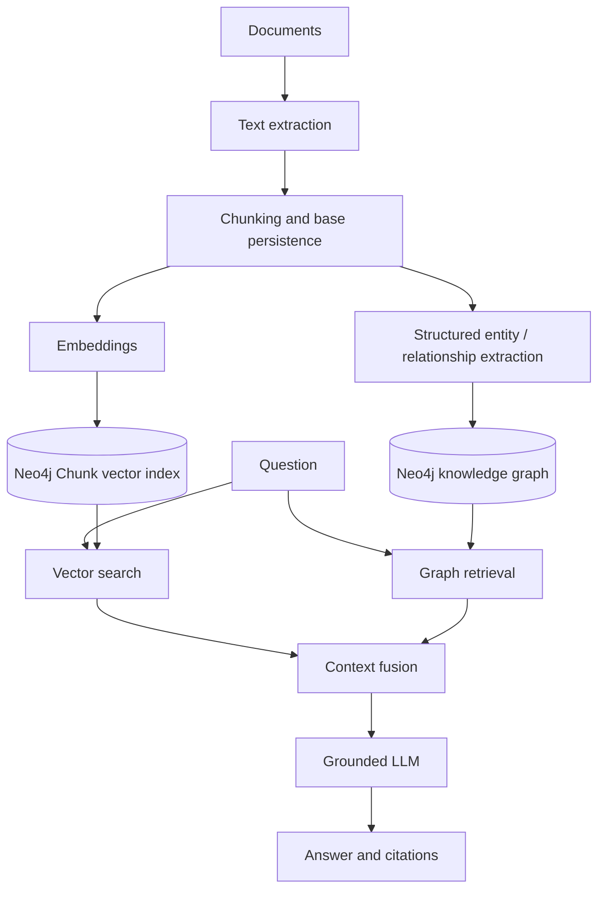
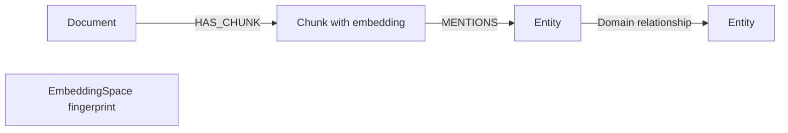
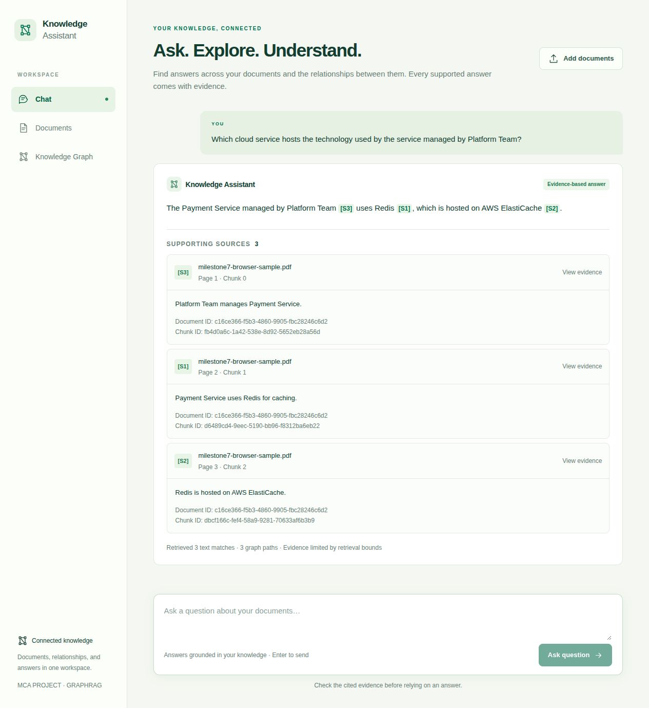
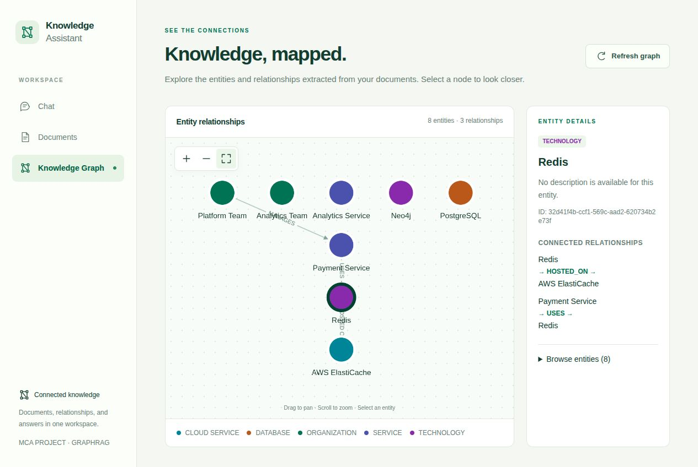
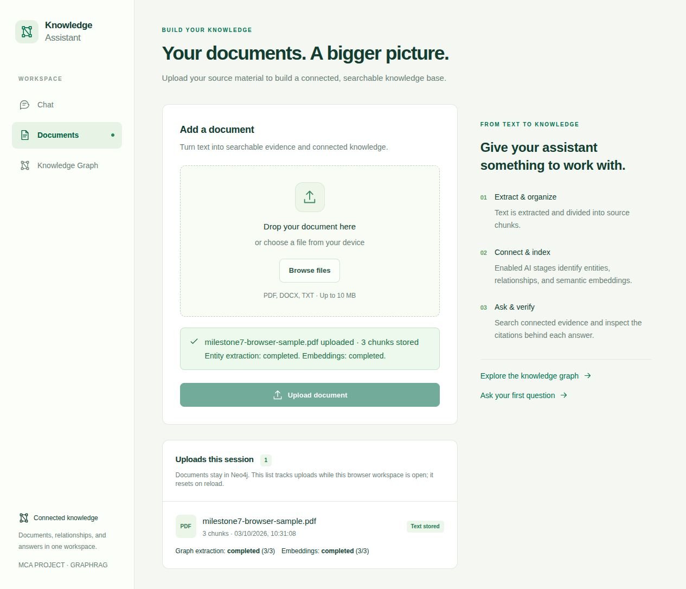

# AI-Powered Knowledge Graph Assistant Using GraphRAG and Large Language Models

## 1. Project overview

MCA final project combining semantic text retrieval and multi-hop relationship evidence for grounded answers with citations. Neo4j is the **only database**, holding the labeled property graph and Chunk vector index. FastAPI serves a Next.js dashboard for documents, chat, and graph inspection.

## 2. Problem statement

Vector retrieval can miss supporting passages for relationship chains spread across chunks. Graph retrieval can recover connected facts but requires careful source provenance. This project combines both forms of evidence and exposes citations and insufficient-evidence outcomes. Real-provider comparative quality has not yet been evaluated.

## 3. Objectives

- Extract and chunk PDF/DOCX/TXT documents with metadata.
- Construct grounded entities/relationships and semantic Chunk vectors in Neo4j.
- Retrieve bounded graph paths and relevant text, fuse context, validate answers/citations.
- Provide an understandable demo and reproducible baseline/evaluation/test reports.

## 4. Features

Implemented upload validation, structured extraction, normalized entity identity, provenance, embedding backfill, cosine vector retrieval, bounded multi-hop search, hybrid grounded answers, expandable source citations, responsive dashboard, Cytoscape visualization, tests, and evaluation CLI. [Project status](docs/project-status.md) distinguishes implemented features from operational/model-quality limitations.

## 5. Architecture



The drawing separates logical responsibilities. Actual synchronous ingestion commits document/chunks, runs embeddings, then knowledge extraction sequentially; query retrieval branches run concurrently. [Detailed architecture](docs/architecture.md).

## 6. Technology stack

Python/FastAPI/Pydantic, async Neo4j driver, OpenAI SDK, pypdf/python-docx, Next.js/React/TypeScript/Tailwind, Cytoscape.js, Docker Compose, pytest, Vitest, Ruff/ESLint/Prettier/tsc. [Verified technologies and versions](docs/mca/05-tools-technologies.md).

## 7. GraphRAG pipeline

Upload → extraction → character-window chunks → Neo4j base storage → embeddings → structured graph extraction/normalization/persistence. Ask → concurrent vector/graph retrieval → verified bounded context → structured answer → citation validation. Provider/DB failures are explicit; they are not fake insufficient answers. Enabled clients belong to FastAPI lifespan.

## 8. Neo4j data model



Document/Chunk/Entity IDs are constrained; Entity(type, normalized_name) is unique. Chunks retain document/page/index metadata and embeddings. Facts retain supporting document/chunk IDs and verbatim quotes; separate chunks can support parallel edges. EmbeddingSpace guards provider/model/dimension compatibility. [Actual schema, constraints, state and Cypher](docs/mca/02-database-design.md).

## 9. Vector retrieval

Configured embedding service → query vector → cosine `chunk_embedding_index` on Chunk.embedding → bounded approximate top-K results with source metadata. Dimensions/model fingerprint are checked, incomplete embedding documents filtered, and missing vectors recoverable through backfill. No other vector database is used.

## 10. Multi-hop graph retrieval

Structured query anchors/intent → exact normalized existing-entity resolution → bounded BFS over allowlisted Entity edges. Default maximum 3 hops, hard upper limit 5; cycles/infrastructure edges excluded. Fan-out/candidates/results/evidence/time are bounded. Actual edge directions and provenance are preserved; ranking is a deterministic heuristic.

## 11. Context fusion

Verify Document-HAS_CHUNK-Chunk ownership, hydrate stored text, deduplicate source pairs/path identities, remove redundant prefixes, and enforce count/serialized-character budgets. Configurable VECTOR_TOP_K, GRAPH_MAX_HOPS, MAX_GRAPH_PATHS, MAX_CONTEXT_CHUNKS and character limits bound supplied evidence.

## 12. Source citations

Backend S IDs represent actual document excerpts; G IDs represent graph paths. Graph facts are document-backed only when the supporting quote exists in supplied text. Unknown/inconsistent citations are rejected with bounded retry. Insufficient answers are canonicalized without sources. Citation validation establishes identity/provenance, not semantic entailment. The frontend only renders backend citations.

## 13. Project structure

```text
backend/src/kg_assistant/
  api/ core/ models/ db/ ingestion/ providers/ prompts/
  services/ retrieval/ evaluation/
backend/tests/                 unit and isolated Neo4j integration tests
frontend/src/app/              chat, documents, graph routes
frontend/src/components/       layout, upload, chat, citations, graph
frontend/src/lib/              API client, contracts, transformations
frontend/tests/                mocked UI/API tests
evaluation/                    dataset, corpus, executed results/reports
docs/                          architecture/API/security/demo/status/MCA material
compose.yaml                   canonical Docker Compose configuration
.env.example                   safe configuration template
```

## 14. Prerequisites

Docker + Compose v2 for the complete local stack. Local development additionally needs Python 3.12/3.13, uv, Node.js **24.15+**, and npm. API credits/model access are needed only for real AI operations. Neo4j Docker is pinned to 5.26.0 Community.

## 15. Installation

From the repository root, create `.env` from `.env.example` **only if it does not already exist**. Set a local Neo4j password (the template placeholder is rejected). For native development:

```bash
uv sync --project backend --locked
cd frontend
npm ci
cp .env.example .env.local
cd ..
```

Do not overwrite existing local credentials. Dependencies are locked in backend/uv.lock, requirements.lock and frontend/package-lock.json.

## 16. Environment configuration

All actual backend fields/examples are documented in [.env.example](.env.example) and the [configuration reference](docs/environment.md). The adapter uses **OPENAI_API_KEY**, **LLM_MODEL**, **EMBEDDING_MODEL**, and **EMBEDDING_DIMENSIONS**; aliases LLM_API_KEY/EMBEDDING_DIMENSION are not implemented.

Full AI ingestion/chat requires LLM_EXTRACTION_ENABLED, EMBEDDING_ENABLED, GRAPH_RETRIEVAL_ENABLED, and GRAPHRAG_ENABLED=true, an actual key, and a Responses structured-output-capable LLM. Default AI flags are false, so upload/dashboard can start without a provider. Embedding model/dimensions must match existing Neo4j data/index. NEXT_PUBLIC_API_BASE_URL and frontend upload limit are public build-time values; never put secrets in NEXT_PUBLIC variables. Restart backend after changing server settings; rebuild frontend after changing public build values.

## 17. Running locally

```bash
docker compose up -d --wait neo4j
uv run --project backend --locked uvicorn kg_assistant.main:create_app \
  --factory --reload --host 127.0.0.1 --port 8000
# In a separate terminal:
cd frontend
npm run dev
```

Root `.env` defaults to the host Neo4j URI; frontend/.env.local supplies its browser API URL. Do not simultaneously bind a Docker backend/frontend to the same ports when running native versions. CORS defaults to http://localhost:3000.

## 18. Docker setup

```bash
docker compose up --build -d --wait
docker compose ps
```

Application http://localhost:3000; API Swagger http://localhost:8000/docs; Neo4j Browser http://localhost:7474. Neo4j login is neo4j with your `.env` password. Compose sets internal backend database URI and initial username/database; those Compose values are fixed to the local neo4j service. Application containers run non-root; ports bind to loopback. Health checks and named data persistence are included. `compose.yaml` is the supported canonical filename; a duplicate docker-compose.yml is unnecessary.

```bash
docker compose logs --tail=100 backend
docker compose stop                 # retain containers/data
docker compose up -d --wait         # resume
docker compose down                # remove containers/network, retain data volume
```

Do not delete the database volume to work around incompatibilities. AI flag/key changes need `docker compose up -d --wait backend`; source changes need `--build`. Readiness checks Neo4j, not provider billing/access. [Security review and public-deployment limitations](docs/security-review.md).

## 19. Testing

```bash
uv run --project backend --locked pytest backend/tests --ignore=backend/tests/integration
uv run --project backend --locked ruff check backend
uv run --project backend --locked ruff format backend --check
cd frontend
npm run test
npm run lint
npm run typecheck
npm run format:check
npm run build
cd ..
```

Use a **separate isolated Neo4j** for the complete suite; it retains a three-dimensional mock embedding index and must not target the application database. Export KG_RUN_NEO4J_TESTS=1 and TEST_NEO4J_URI/USERNAME/PASSWORD/DATABASE for that instance, then:

```bash
uv run --project backend --locked pytest backend/tests \
  --junitxml=evaluation/test-results/backend.xml
cd frontend
npm run test -- --reporter=default --reporter=junit \
  --outputFile.junit=../evaluation/test-results/frontend.xml
cd ..
uv run --project backend --locked python -m kg_assistant.evaluation.test_report
```

[Testing approach and executed test tables](docs/mca/04-testing.md); [final verification](docs/milestone9-verification.md). Real-Neo4j E2E tests mock AI providers and verify upload→graph/vectors→answer/citations. They do not establish live-model quality.

## 20. Evaluation

```bash
uv run --project backend --locked python -m kg_assistant.evaluation.run --mode mock
```

Default eight-question scripted evaluation produces [results.json](evaluation/results.json) and [report.md](evaluation/report.md) without paid API calls. Dataset categories include factual, semantic, relationship, multi-hop, insufficiency. Missing/ambiguous annotations or provider usage are null/N/A. Real-provider manual setup and `--mode live` are described in [the detailed evaluation guide](docs/implementation-guide.md#milestone-8-evaluation-and-test-case-reports). Live outputs default to ignored evaluation/runs/; monetary cost is not fabricated.

## 21. Vector RAG vs GraphRAG comparison

The evaluation-only vector baseline uses text chunks and the same production embedding/vector/answer components/prompt; it never retrieves graph facts. Hybrid uses production GraphRAGService. Paired top-K/settings, alternating mode order, raw evidence, measured latency, error/metric denominators and optional token usage make results inspectable. Exact/name/path proxies do not fully measure semantic quality. Scripted scores are **framework verification, not an empirical improvement claim**. Live-provider quality: **Not evaluated yet**.

## 22. Screenshots

Existing captures are historical Milestone 7 demonstrations with real Neo4j and mocked AI providers; they are not new live-provider results. [Capture record](docs/milestone7-verification.md).





## 23. Limitations

No auth/tenant isolation, rate limiting, TLS ingress, durable ingestion workers, OCR, rendered DOCX pages, fuzzy alias/homonym resolution, document listing/deletion API, external reranker, arbitrary Cypher, automated backups or public deployment infrastructure. Upload history is session memory. Retrieval/context bounds can truncate evidence; approximate vector search is not exhaustive. Synchronous processing and model extraction can fail/produce partial states. Prompt/quote/citation checks cannot guarantee entailment. Actual provider access/key validity and live answer quality need user-run verification. [Full status](docs/project-status.md).

## 24. Future enhancements

Potential future work includes OCR, durable job/status infrastructure, alias resolution, independently annotated larger live evaluation, auth/quotas, backup/restore operations and public ingress controls. These are not implemented features. Milestone 9 is the final authorized milestone.

[Demo document and procedure](docs/demo.md) · [API reference](docs/api.md) · [Architecture](docs/architecture.md) · [MCA report material](docs/mca/01-system-design.md) · [Detailed implementation/recovery reference](docs/implementation-guide.md)

## 25. Viva presentation

The project viva deck is available as [PowerPoint](presentations/GraphRAG_Project_Viva_Template.pptx) and [PDF](presentations/GraphRAG_Project_Viva_Template.pdf). The deck follows the supplied SRM template and includes the project architecture, Neo4j data model, screenshots, and evaluation limitations.
