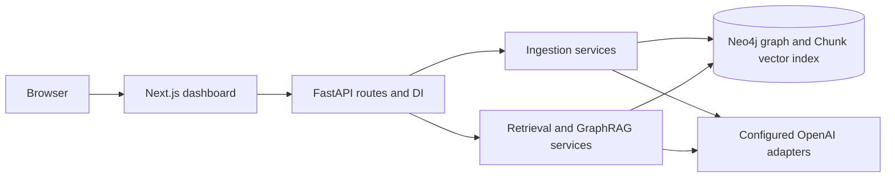
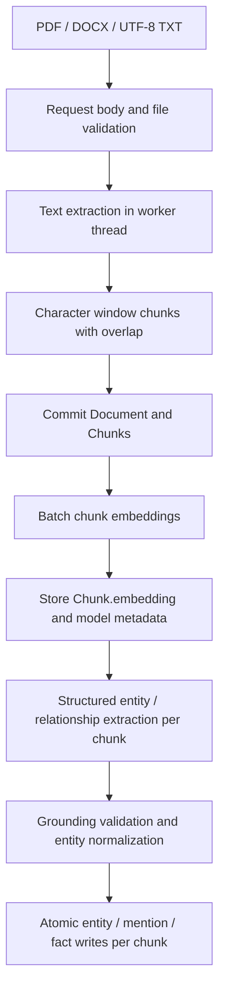
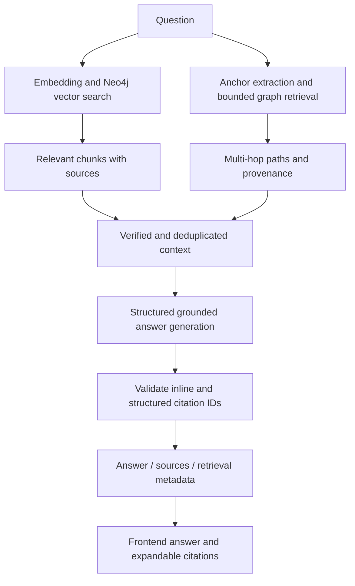

# Implemented system architecture

The system is a modular monorepo. Next.js App Router presents Documents, Knowledge Graph, and Chat. The browser calls FastAPI directly through the public backend base URL. FastAPI routes validate Pydantic contracts and inject services. Services own orchestration; repositories own Cypher; provider adapters own asynchronous external AI requests. Neo4j is the only database, storing both the labeled property graph and Chunk vectors. There is no separate vector database or Text-to-Cypher executor.

## Document ingestion and knowledge extraction

This describes the **actual sequential upload implementation**: base storage, embedding stage, then graph extraction. The embedding and graph operations are logically independent but are not concurrent ingestion workers. Feature flags can independently disable stages. Parsing/CPU work uses a thread pool; Neo4j and provider I/O are async. Uploads process synchronously. There is no durable background queue.

TXT must be UTF-8; PDF text is extracted page by page; DOCX preserves main-body paragraph/table order. Image-only PDFs need unavailable OCR. Chunk windows preserve whitespace and never cross PDF pages; page numbers start at 1 and chunk indices at 0. Entity extraction uses Responses/Pydantic structured output, configurable semantic types, local entity keys, and verbatim evidence quotes. Relationships must reference extracted keys and quote both endpoint names. Validation establishes source grounding, not semantic entailment.

Entities are matched by `(type, normalized_name)` after Unicode NFKC, case folding, and whitespace collapse. IDs are UUID5-derived; the first display name is preserved. Facts get stable per-chunk IDs, supporting repeat ingestion without duplicate facts. Separate chunks can independently support the same semantic edge. Each chunk's entities, mentions, facts, and completion state are committed atomically. Document run ownership/leases prevent concurrent/stale graph writes; missing-vector claims have their own leases. Errors remain explicit and recoverable through retry/backfill endpoints.

## Vector retrieval

Question → embedding service → query vector → `chunk_embedding_index` → relevant Chunks → Document source metadata through HAS_CHUNK. Dimensions, finite numeric values, and provider/model compatibility are validated. The index is cosine-based and created idempotently. An EmbeddingSpace node protects against mixing models even when dimensions match. Approximate search oversamples candidates with bounded limits; filtered results may be fewer than top-K. Chunks in documents with incomplete embeddings are excluded. Only Chunk nodes receive vectors.

## Graph retrieval

Question → structured anchor extraction and retrieval intent → exact normalized entity resolution → application-controlled BFS → bounded ranked paths. Retrieval is read-only. Repository queries fetch controlled single-hop Entity neighbors and evidence; they never run arbitrary or LLM-generated Cypher. Depth defaults to 3 and cannot exceed 5. Bounds cover anchors, fan-out, candidates, results, evidence, and elapsed time. Repeated nodes are rejected per path. HAS_CHUNK and MENTIONS are excluded from domain traversal.

Actual relationship directions are preserved, including when traversed in reverse. Ranking rewards ordered relationship-prefix agreement, target type, fewer hops, and provenance availability with stable tie breaking. It is a heuristic, not model confidence. Facts backed by known unfinished extraction documents are hidden; unknown/unavailable provenance remains graph-only evidence.

## Hybrid query pipeline

The production GraphRAGService runs both retrievers concurrently and awaits both outcomes. Branch failure produces an explicit error; it is never silently treated as empty evidence. ContextRepository verifies source identity and hydrates stored text. ContextBuilder deduplicates `(document_id, chunk_id)` and directed path identities, removes redundant prefixes, and enforces count and serialized-character budgets. Graph paths reserve part of the context budget; vector-only evidence can use the text allocation without graph content.

S1, S2, etc. identify supplied document chunks; G1, G2 identify graph paths. A graph edge links to S evidence only if its stored quote occurs in the actual supplied excerpt. Missing provenance is never promoted to a document citation. The answer prompt treats question/source contents as untrusted and requires evidence-only answers. Unknown/inconsistent citation IDs are rejected with bounded retry, then a sanitized 502. A supported answer requires a citation. No evidence bypasses the LLM with a canonical insufficient-evidence response; model-reported insufficiency is canonicalized without sources.

## Frontend and lifecycle

The API client centralizes fetch/XHR, URLs, cancellation, timeouts, and error handling. Upload phases reflect actual transfer and synchronous processing. Session document history is React memory, not a database listing. Chat renders plain text and backend-provided citations; it does not generate sources. Cytoscape uses actual bounded Entity graph API data; click/keyboard inspection, fit, zoom, and pan are implemented. Instances and ResizeObservers are destroyed on unmount. There are no API keys or Neo4j credentials in browser configuration.

One Neo4j driver and enabled provider clients belong to each FastAPI lifespan; request operations own sessions. Shutdown closes all resources. Errors and JSON logs use sanitized codes/classes, counts, correlation IDs, and elapsed time. Health readiness tests Neo4j connectivity, not provider credentials or model quality.

## Evaluation boundary

The evaluation-only Vector RAG baseline reuses production vector/context/answer components with empty graph input and never calls graph retrieval. Hybrid evaluation uses production GraphRAGService. Default scripted fixtures verify composition and metrics; actual model quality remains unevaluated. Missing ground truth/token usage is null. Live evaluation uses existing configured Neo4j data and providers; private outputs default to ignored directories. See [testing](mca/04-testing.md), [schema](mca/02-database-design.md), and [API reference](api.md).
