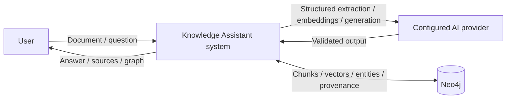
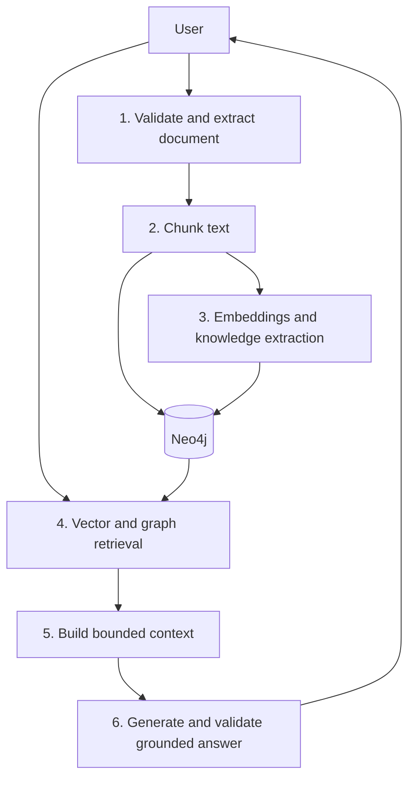
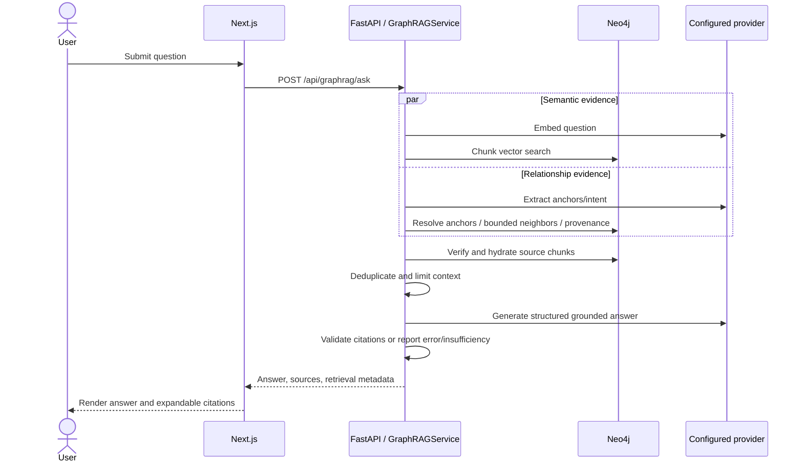

# System design

## Problem and objectives

Semantic text retrieval can miss a relationship chain spread across supporting chunks. This project combines Chunk similarity search and a labeled property graph to expose both passages and multi-hop facts to a grounded answer generator. Objectives are modular ingestion, bounded retrieval, source provenance, honest insufficient-evidence handling, and reproducible comparison against a text-only baseline. Improvement in real-model quality is a research question; it has not been established by scripted tests.

## Modules and interactions

The frontend contains layout, upload/session history, chat/citations, and Cytoscape visualization. FastAPI route contracts inject settings, services, driver/repositories, and enabled providers. Extraction/chunking, knowledge graph persistence, embeddings/vector retrieval, query anchor extraction/BFS, context fusion, and answer validation are separate modules. See [architecture](../architecture.md) and [API](../api.md) for actual interactions.

## Context DFD reference

## Level-one DFD reference

These diagrams describe data flow; they are references for formal DFD/UML artwork, not claims of additional services or concurrent ingestion. The actual upload stages execute sequentially after base persistence; query retrieval branches execute concurrently.

## Query sequence reference

No-evidence questions bypass generation. Provider/retrieval errors are explicit rather than being labeled insufficient. The application has no auth/users/tenant model, background queue, external vector store, or arbitrary Cypher route. [Status](../project-status.md) records these boundaries.
