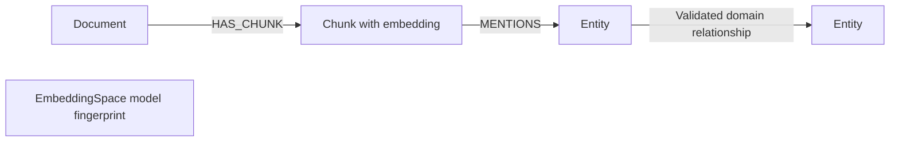

# Database design: actual Neo4j schema

Neo4j 5.26.0 Community is the configured Docker database. Both the property graph and cosine vector index are stored here. API/provider embeddings are generated externally and persisted on Chunk nodes; no Document or Entity embeddings are generated.



| Node | Actual persisted properties |
|---|---|
| Document | id, filename, file_type, created_at; extraction_status and extraction run/lease/lock properties |
| Chunk | id, document_id, text, chunk_index, page_number when available; embedding, embedding_provider, embedding_model, embedding_dimensions; embedding status/error/run/lease/lock properties; extraction status/attempt/model/error state |
| Entity | id, name, normalized_name, type, optional description |
| EmbeddingSpace | id=`chunk_embedding_index`, provider, model, dimensions, lock |

Neo4j omits properties assigned null; DOCX/TXT pages therefore have no page_number. created_at is a Neo4j datetime. Extraction/embedding state and run properties are operational bookkeeping, not domain facts. Successful writes remove stale error/lease fields where the repositories do so. Read `db/repositories/knowledge_graph.py` and `vectors.py` for exact status transitions; no imaginary user/tenant tables exist.

| Relationship | Implemented meaning/properties |
|---|---|
| HAS_CHUNK | Document owns Chunk; chunk stores its document_id as well |
| MENTIONS | Chunk mentions Entity; source_document_id and evidence_quote |
| Domain fact | Entity → Entity; id, source_chunk_id, source_document_id, evidence_quote, optional description |

The default domain allowlist is WORKS_ON, USES, MANAGES, DEPENDS_ON, HOSTED_ON, PART_OF, BELONGS_TO, CREATED_BY, LOCATED_IN, RELATED_TO. These are supported extraction types, not a claim that every type already exists in a database. Server configuration can extend uppercase identifiers. HAS_CHUNK and MENTIONS remain reserved. Fixed Cypher templates are compiled only from validated server configuration; values are parameterized.

Entity identity is `(type, normalized_name)` with NFKC/case/whitespace normalization and a deterministic UUID5 ID. It preserves the first canonical display spelling and does not merge homonyms across types or resolve aliases. Fact IDs are deterministic over chunk, source, type, and target. Separate supporting chunks can create parallel fact edges; the display API collapses those edges only for visualization. Graph retrieval retains provenance.

## Constraints and indexes

| Name | Actual declaration |
|---|---|
| document_id_unique | Document.id unique |
| chunk_id_unique | Chunk.id unique |
| entity_id_unique | Entity.id unique |
| entity_identity_unique | Composite uniqueness on Entity(type, normalized_name) |
| embedding_space_id | EmbeddingSpace.id unique |
| chunk_embedding_index | VECTOR index on Chunk.embedding; configured dimensions, cosine |

Constraints provide their Neo4j backing indexes. No custom full-text, entity vector, or separate similarity database is implemented. Schema setup is lazy/idempotent through ingestion or vector setup. DDL executes separately from document data transactions. An unused fresh database may therefore lack these schema objects until the corresponding operation runs. Vector setup verifies actual options/state and the EmbeddingSpace fingerprint, rejecting unidentified/mixed model data with 409 rather than replacing the index.

## Inspection

```cypher
SHOW CONSTRAINTS;
SHOW VECTOR INDEXES;
MATCH (d:Document)-[:HAS_CHUNK]->(c:Chunk)
RETURN d.id, d.filename, c.id, c.chunk_index, c.page_number,
       size(c.embedding) AS embedding_dimensions LIMIT 25;
MATCH (s:EmbeddingSpace) RETURN s;
MATCH (c:Chunk)-[m:MENTIONS]->(e:Entity)
RETURN c.id, e.name, e.type, m.evidence_quote LIMIT 25;
MATCH (a:Entity)-[r]->(b:Entity)
RETURN a.name, type(r), b.name, r.source_document_id,
       r.source_chunk_id, r.evidence_quote LIMIT 25;
```

To view the demo chain without infrastructure edges, open Neo4j Browser's graph result:

```cypher
MATCH p=(a:Entity {normalized_name:'platform team'})
  -[:MANAGES|USES|HOSTED_ON*1..3]->(b:Entity)
WHERE all(n IN nodes(p) WHERE n:Entity)
  AND all(n IN nodes(p) WHERE single(x IN nodes(p) WHERE x = n))
RETURN p LIMIT 25;
```

For a returned document citation, set copied IDs and verify ownership/text:

```cypher
:param document_id => 'copied-document-id';
:param chunk_id => 'copied-chunk-id';
MATCH (d:Document {id:$document_id})-[:HAS_CHUNK]->(c:Chunk {id:$chunk_id})
RETURN d.filename, c.page_number, c.chunk_index, c.text;
```

The Compose named volume persists Neo4j data across normal restarts. No automated backup, restore pipeline, retention policy, or document deletion API is implemented. Do not drop volumes to solve model incompatibility; use a deliberately separate corpus/database or plan an explicit migration.
